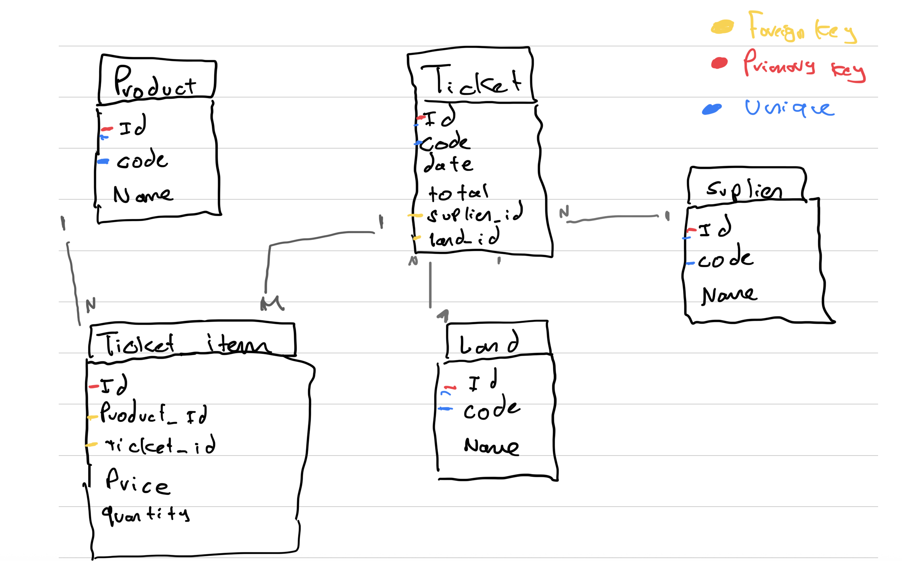

# Analysis and decisions

## Findings

1. The same product has different prices.
2. A ticket can have different products.
3. The same product has different suppliers.
4. One supplier per ticket, same for land.
5. Land is where the purchase is made, not where the product is.
6. Ticket total does NOT exist. The total we see is the product quantity times the price.
7. There are lines with quantity 0.
8. In some tickets there are duplicated products.
9. One ticket code has 5 digits and the rest have 7.
10. The real total of the purchase is not there yet. We still need to decide if we calculate it or store it. (Decided: it is calculated, see Data model, 4.)
11. Land and supplier names stay the same in the whole file.

## Decisions

### Data model
1. Each table has its own ID as primary key, and code as a unique field. The code comes from an outside source typed by hand and it can change, so it is not stable as a primary key. Also, we see inconsistent format in the ticket code, so as a basic standard we will use id as primary key in all of them.
2. One supplier and one land per ticket, so `supplier_id` and `land_id` are in `tickets`. They are not in `products`, because the same product has different suppliers, and the land is where the purchase is made, not where the product is.
3. The price is in `ticket_items`, not in `products`, because the same product has different prices.
4. Ticket total is not stored. It is calculated when we query (sum of quantity x price of its items).
5. All tables have `created_at` and `updated_at`.
6. `tickets.date` is `DATEONLY`, the Excel has no time.
7. `quantity` and `price` are `DECIMAL(12, 3)`, the Excel has decimals.
8. On delete:
   - `tickets.supplier_id` and `tickets.land_id`: `RESTRICT`. A supplier or land with tickets cannot be deleted.
   - `ticket_items.ticket_id`: `CASCADE`. Deleting a ticket deletes its items.
   - `ticket_items.product_id`: `RESTRICT`. A product used in tickets cannot be deleted.
9. `ticket_items` is a separate table between `tickets` and `products`. A ticket can have many products, so each line has its product, `quantity` and `price`.
10. There is no unique rule on ticket + product, because the same product can be repeated inside a ticket.
11. The ticket `code` is a `STRING`, not a number, because its format is not consistent (5 digits in one, 7 in the rest).
12. Suppliers, lands and products are saved once in their own tables, because their names stay the same in the whole file.

**Why**

*Supplier and land in the ticket.* My first idea was to put the supplier in `products`, but the same product has different suppliers (finding 3), so a product would be tied to only one. The ticket knows who sold each purchase: it has one supplier and one land (findings 4 and 5). The land is where the purchase is made, not where the product is.

*The total is calculated.* The file has no ticket total (finding 6). If I store it, it can be different from its items after an update. If I calculate it, it is always correct.

Model:

### Data import
- We import everything as it is in the Excel.
  - Lines with quantity 0 are imported. They add 0 to the total, so they do not affect the payments, and we do not lose information.
  - Duplicated products inside a ticket are imported as separate lines. The sum per ticket is the same.
- The import is an extra script of the project: `npm run import`. It is not part of the migrations, it must be run after them.
- The Excel file is in `data/tickets-prueba.xlsx`, so anyone with the repo can load the data.
- Order: suppliers, lands and products first, then tickets, then ticket items. Each one needs the ids of the previous ones.
- Everything runs in one transaction. If something fails, nothing is saved.
- If the database already has tickets, the import is canceled, so it does not duplicate data.

### Setup
- Migrations are in `src/migrations`, configured with `.sequelizerc`.
- The database runs in Docker (PostgreSQL 18) with a named volume.
- Scripts: `start`, `dev` (`node --watch`), `format`, `migrate`, `import`.
- Stack required by the test: Node.js, Express, PostgreSQL and Sequelize. The rest is our choice: `dotenv`, `cors`, `exceljs` and Prettier.
- We use the latest stable versions of everything, to avoid problems with old ones.
- CommonJS (`require`) instead of ES modules (`import`). It is what Sequelize and its CLI use by default, so there is less configuration.
- `node --watch` instead of `nodemon` to restart in development, so there is one dependency less.
- The database credentials go in `.env`, which is not uploaded to the repo. `.env.example` has the values to copy.
- The database structure is created only by migrations, as the test asks.

### Server and connection
- `app.js` only configures Express (middlewares, routes, error handler). It has no side effects, so it can be imported without starting the server or connecting to the DB.
- `server.js` starts the process: it connects to the DB, opens the port and handles the shutdown.
- The connection is created once in `src/config/database.js` and shared by all the models.
- The connection uses a pool: `max: 5`, `min: 0`, `acquire: 30000`, `idle: 10000`. Connections are opened when they are needed, up to the max, and closed after the idle time.
- `DB.authenticate()` runs once when the server starts. If the DB does not answer, the server does not start.
- On `SIGTERM` and `SIGINT` the HTTP server is closed first, then the pool (`DB.close()`).
- `cors` only allows the frontend origin (`http://localhost:5173`), set in `CORS_ORIGIN`. The frontend runs in another port, so without it the browser blocks the requests.

### Sequelize models
- Models only describe the tables, they do not create them. The migrations create the tables.
- Model and migration must be kept equal by hand.
- `underscored: true` so the columns are `created_at` and `updated_at`.
- Relations are declared in `src/models/index.js`, both sides of each one (`hasMany` and `belongsTo`). The delete rules are applied by the database, not by Sequelize.
- `DECIMAL` fields come as strings from PostgreSQL (`"1475.000"`). We must remember this when we calculate totals.

### Services
- Order of work: from the database out (models, services, controllers, routes), one endpoint at a time.
- Each service wraps the database query in a `try/catch`. If it fails, it throws a `DatabaseError` and keeps the original error in `cause`.
- A "not found" is thrown outside of the `try/catch`, so it is not turned into a `DatabaseError`.
- Creating and updating a ticket use a transaction: the ticket and its items are saved together.
- The total of a ticket is a subquery (`TOTAL` in `ticket.service.js`) inside the same query. It is shared by the list, the detail and the payments, so there is no extra query per ticket (no N+1).
- The supplier and the land of a ticket are loaded with `include` (a JOIN) in the same query, not one query per ticket.

### Controllers
- Controllers read the request and send the response. They do not catch errors, Express 5 sends them to the error handler.
- Only the list of tickets and the payments can be sorted, with `sort` and `order` (`asc` or `desc`). Suppliers, lands and products have a fixed order (by `id`). Only a fixed list of fields is allowed for each one (tickets: `date`, `code`, `id`; payments: supplier `name`, `code`). Any other value answers `400`.
- The list of tickets is paginated: `page` (default 1) and `limit` (default 20, maximum 100). It does not include the items, only `GET /tickets/:id` does.

### Routes
- Routes are registered in `src/routes/index.js`, not in `app.js`.
- Each resource is identified by its `id` in the URL (`/api/suppliers/:id`), because the `code` can change.
- `PUT` replaces the resource. For a ticket it replaces all its items. There is no `PATCH`.
- `DELETE` answers `204` with no body.
- A ticket is created and updated with its items in the same body (`items`), there is no separate endpoint for the items.

### Error handling
- One global error handler, the last middleware registered in `app.js`.
- Errors have a flag `isOperational`:
  - Expected errors (not found, conflict) use a custom error. The handler returns its status and message.
  - Unexpected errors (DB down, bugs) are logged and return a generic `500`, without details. The client never sees database errors.
- Custom errors are in `src/utils/errors.js` and all extend `AppError`.
- Errors bubble up: the service throws, the controller does not catch.
- Each service catches the errors it expects and throws a custom error. Any other error becomes a `DatabaseError`, with the original in `cause`, so it is logged and the client only gets a generic `500`.
- We do not translate Sequelize errors in a central place. We throw custom errors where the error happens, because a central translator grows with every new source of errors and the messages are generic.
- Deleting a supplier, land or product that is used in tickets answers `409`. PostgreSQL reports it with the code `23001`, which Sequelize does not turn into a `ForeignKeyConstraintError`, so the service checks that code.
- If a ticket points to a supplier, land or product that does not exist, it answers `400` (`BadRequestError`). A repeated ticket `code` answers `409`.
- Errors from libraries with a 4xx status (for example an invalid JSON body) are returned with that status, not as `500`.
- Logs use `console` for now: `console.warn` for expected errors, `console.error` with the full error for unexpected ones.

**Why**

The client must not see database errors, they show details of our tables. Unexpected errors are logged with all the details and the client only gets a generic `500`. I did not build a central translator of Sequelize errors: it grows with every new error. Each service throws the right error where it happens.

### Weekly payments (bonus)
- One endpoint, `GET /api/payments?year=&week=`, with its service, controller and route, without new utils.
- It uses the Sequelize models: `Ticket.findAll` with `include` of the supplier. It is one query, so there is no N+1.
- Only the week filter is SQL, because Sequelize does not have the ISO week: `EXTRACT(isoyear ...)` and `EXTRACT(week ...)`. The ISO week has its own year, which is not always the year of the date. JavaScript does not have the ISO week.
- The total of each ticket comes from the shared `TOTAL`. The total of each supplier and of the week are added in JavaScript, in thousandths (whole numbers), because the totals come as text and this way there are no decimal errors.
- The response is nested: supplier, then its tickets, with the total of each level. The test asks for the detail of the tickets, so we list the tickets and not their items (the items are in `GET /tickets/:id`).
- A week without tickets answers `200` with an empty list and total 0. A ticket with all its items in quantity 0 is included, with total 0.
- A `year` or `week` that is missing or is not a whole number answers `400`. It is checked inside the controller, without Zod.

**Why**

I first wrote the payments as one big SQL query, but it was long, it did not match the rest of the project and a change in a table would break it without warning. With the models it is shorter and still one query (no N+1). The only SQL left is the ISO week, because Sequelize does not have it.

At first the suppliers came ordered by `id`, which says nothing to a person, so now they are ordered by name. The order can be chosen with `sort` and `order`, but only from a fixed list of fields: the field name ends inside the query, so I do not accept anything the client sends. One fixed order is enough for the test, so I did not add more options.

The test asks for the detail of the tickets bought from each supplier. I list the tickets with their total, and the items are in `GET /tickets/:id`.

### Left for later
- Validation of the request data with Zod (missing fields and ids that are not a number should be a `400`, today they are a `500`).
- Indexes on the foreign keys and on `tickets.date`. For now the tables are small.
- `helmet` and the rate limit.
- Filter by `code`.
- Use `database.js` in the import script, it creates its own connection now.
- Choose the Node version and fix it with `.nvmrc`.
- Prettier rules (`.prettierrc`).

### Not added
- Authentication, the test does not ask for it.
- A `notFound` middleware for routes that do not exist. They answer with the default `Cannot GET`.
- A library for logs (`pino`), `console` is enough for now.
- A central translator of Sequelize errors, see Error handling.
